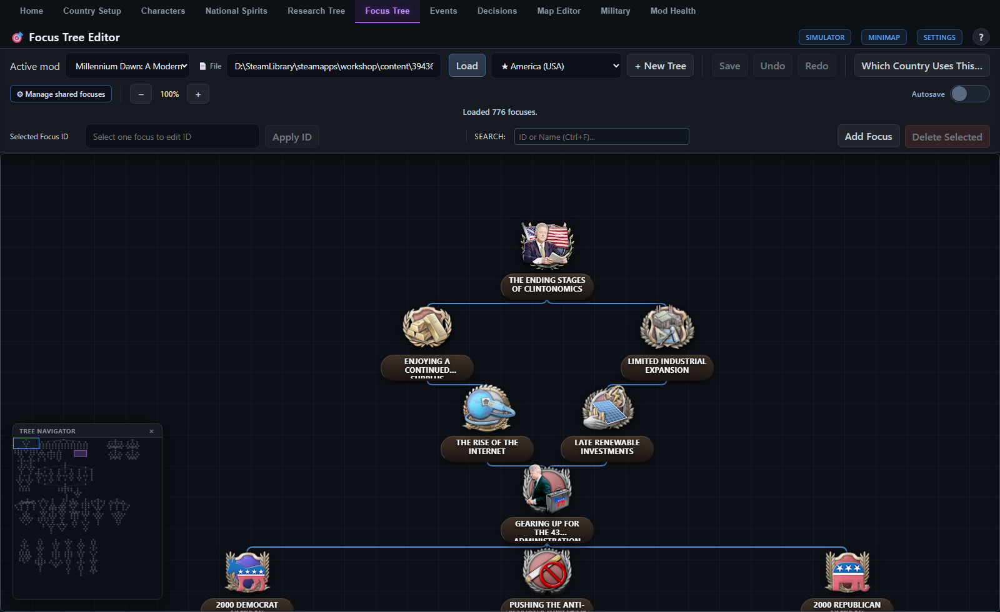
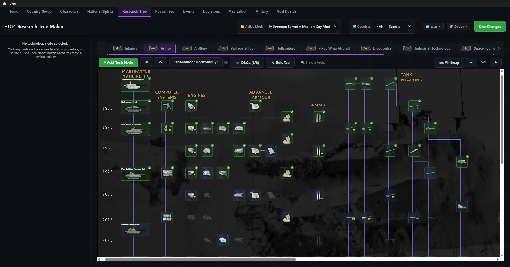
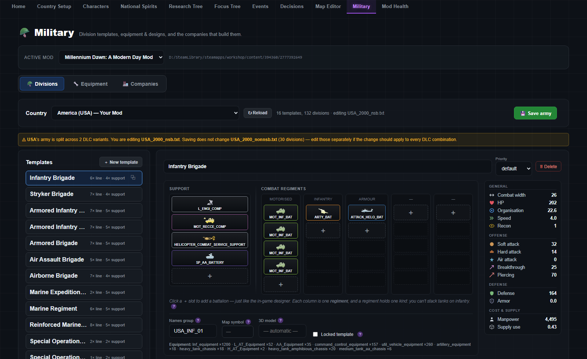
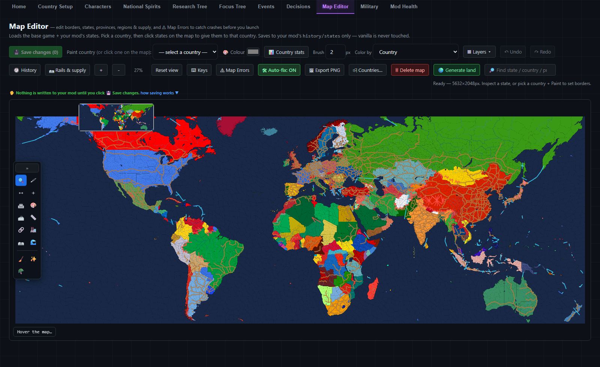

# Nova Modding Suite

### 💬 [Join the Discord](https://discord.gg/Z6P23hjEsM) — **please report any bugs you find there.**

**A visual editor for Hearts of Iron IV mods.** Focus trees, research, events, decisions, national spirits, characters, country setups, a full military maker and a map editor — without hand-writing Paradox script.

Nova reads the game the way HOI4 does (base game → dependencies → your mod) and writes **only to your own mod**. Vanilla and the mods you depend on are opened read-only.

> Not affiliated with or endorsed by Paradox Interactive. Hearts of Iron IV is a trademark of Paradox Interactive.

---


*Focus tree editor — Millennium Dawn's USA tree, 776 focuses, with the tree navigator open.*


*Research tree — drawn from your mod's own `.gui` geometry, sprites and fonts, so it matches what the game will show.*


*Military — the division designer on the game's own regiment grid, with live stats.*


*Map editor — states, provinces, supply, rails and borders. Nothing is written until you press Save.*

---

## What's inside

| Tool | What it does |
|------|--------------|
| **Country Setup** | Create a country or edit an existing one — ideology, ruling party, popularities, spirits, capital (picked on the map), starting tech and equipment. |
| **Focus Tree** | Drag-and-drop designer with a deep effect/trigger engine, shared and continuous focuses, a simulator, and a plain-English preview of what each focus does. |
| **Research Tree** | Custom tabs, techs and equipment, drawn with your mod's real tree geometry. Year rails, section labels, folder backgrounds, undo/redo, and a minimap. |
| **Events** | Options, triggers, MTTH and typed fire dates, `after`, timeouts — previewed in the game's real event windows (newspaper, report, military leader, operative). |
| **Decisions** | Categories and missions with costs, timers, cooldowns, targets and the full advanced field set. |
| **National Spirits** | Country ideas with modifiers, equipment bonuses, research bonuses and AI hints. |
| **Characters** | Country leaders, advisors, generals and admirals — traits, portraits, and a visual portrait browser. |
| **Military** | Division templates on the game's own designer grid; the arsenal of every country's equipment; modular variants; custom modules and upgrades; manufacturers (MIOs) and designer companies; starting stockpiles, fleets and air forces; and orders of battle you can place on the map. |
| **Map Editor** | State ownership, cores, manpower, buildings, resources, victory points, province moves, strategic regions, terrain, rivers, rails and province painting, a country card for any country you select, and **Generate a world**, which builds a whole new world for a mod from one button. |
| **Mod Health** | Validation with a score, grouped issues, deep links into the right maker, and some auto-fixes. |

**Genesis** turns scripted content into plain English throughout, so you can read a focus, spirit or decision back as a sentence instead of a wall of tokens.

## About saving

Nova writes to your mod folder, so it is worth being clear about what it does and does not do.

- Every write goes through one path that **backs the file up first** — into Nova's own data folder, not inside your mod — writes to a temp file, then swaps it in, so an interrupted save cannot leave a half-written file. It retries if antivirus is holding the file open.
- Before saving the map it **checks for the problems the game refuses to load or has crashed on** and refuses to write them, and it warns about the rest. For each problem it stops Save for, it says whether the game refuses to load it, has crashed on it, or has never been tried with it.
- It will not touch vanilla, the mods you depend on, or Workshop downloads. Only your active mod.

None of that is a guarantee. **Keep your own backups of anything you care about** — the app says the same thing on first run. If something does go wrong, the in-app diagnostics bundle the game's logs and the newest crash dump into one report.

---

## Download

Grab the latest `.exe` from the [Releases](../../releases) page and run it. It is portable — no installer.

Nova checks the releases page on startup and tells you when a newer version is out.

> The build isn't code-signed, so Windows SmartScreen will likely show *"Windows protected your PC."* Choose **More info → Run anyway**.

**Requirements:** Windows (x64) and Hearts of Iron IV installed — Nova reads the game's assets and localisation from your existing copy. Nova 1.0.7 is made for Hearts of Iron IV 1.20. It finds the game in any Steam library, and the Game folder setting on Home shows which copy it uses and lets you choose another.

---

## Bugs and feedback

**Report bugs on the [Discord](https://discord.gg/Z6P23hjEsM)** — that's where they get seen and answered fastest.

Whatever you report, these three things help more than anything else: **which mod you were editing**, **what you were doing when it went wrong**, and the **diagnostics report** if the app produced one.

## Source code

Nova is open source. The [`source`](https://github.com/Ultra-XT/HOI4-Modding-Suite/tree/main/source) folder of this repository holds the code of the current release. To run it, install [Node.js](https://nodejs.org/) and Hearts of Iron IV, then:

```
cd source
npm install
npm run desktop
```

`npm run build` makes the portable `.exe`, and `npm test` runs the unit tests (about 20 minutes). Run the end-to-end tests only through `node run-e2e.js`: run on their own, they create mods in your real Paradox mod folder.

## Licence

**MIT.** See [LICENSE](LICENSE). From 1.0.7 on, Nova is open source: you may use, copy, change and share it, and publish your own version of it, as long as the licence and its copyright notice go with it. Anything *you* build with Nova is yours; the licence covers Nova itself, not your mods.

Releases before 1.0.7 keep the licence they were released with. The parts of Nova made by others (Electron, FFmpeg, libvips and the rest) keep their own licences; see THIRD-PARTY-NOTICES.txt on each release, where their source code is offered too.

HEARTS OF IRON and PARADOX INTERACTIVE are trademarks and/or registered trademarks of Paradox Interactive AB. Nova is an independent tool, not affiliated with or endorsed by Paradox Interactive. Hearts of Iron IV's game files and artwork belong to Paradox Interactive and are not licensed by Nova's licence.
